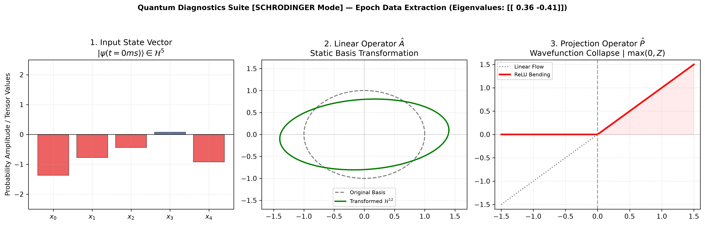
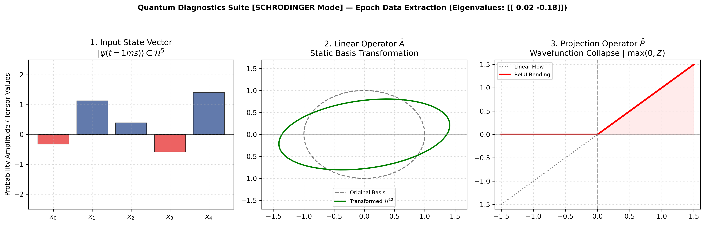
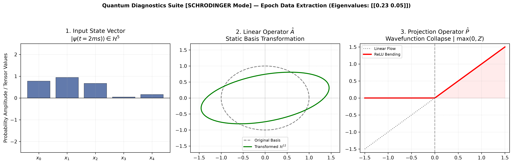
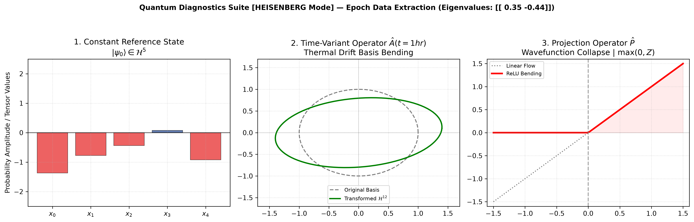

# Quantum Metrology Engine: Time-Variant Hardware Verification Framework

An advanced, production-grade automated metrology and hardware validation framework that bridges **Deep Learning** (`PyTorch`) with **Quantum Mechanical formalisms**. The engine simulates, visualizes, and automatically verifies continuous **Modulation Transfer Function (MTF)** parameters and high-frequency signal integrity tracks for state-of-the-art optical systems (e.g., industrial cameras) integrated into complex healthcare electro-optical platforms (such as **Synoia Technologies** mainboards).

The unique core of this project maps the forward pass matrix transformations of a Multi-Layer Perceptron (MLP) directly onto **Schrödinger and Heisenberg time-evolution mechanics** inside a multi-dimensional Hilbert Space (H).

---

## 1. Quantum Mechanical Foundational Principles

To bridge physical hardware validation data with neural compute graphs, this framework models data state transitions under the strict mathematical boundaries of non-relativistic quantum mechanics:

### 1.1 The State Vector and Hilbert Space
Any isolated physical system is fully defined by its quantum state, represented as a state vector:
$$|\psi\rangle$$

This vector resides within a complex vector space equipped with an inner product, known as a **Hilbert Space (H)**. The dimensionality of this space corresponds to the degrees of freedom under test. The components of the vector represent complex probability amplitudes, where the inner product satisfies:
$$\langle\psi|\psi\rangle = 1$$

### 1.2 Linear Operators and Physical Observables
A transformation of a quantum state or the extraction of a measurable quantity is executed via a **Linear Operator**:
$$\hat{A}: H \rightarrow H$$

Physical variables (such as energy, momentum, or structural width) are represented by self-adjoint, **Hermitian operators**:
$$\hat{O} = \hat{O}^\dagger$$

According to the spectral theorem, the only possible outcomes of measuring an observable are its real **Eigenvalues ($\lambda$)**, derived from the characteristic eigenvalue equation:
$$\hat{O}|\phi_n\rangle = \lambda_n|\phi_n\rangle$$

### 1.3 State Projection and Wavefunction Collapse
When a measurement is conducted on a system in a state $|\psi\rangle$, the wavefunction instantaneously alters. It undergoes a non-reversible **Wavefunction Collapse** into one of the eigenstates of the observable being measured. This action is modeled via a **Projection Operator**:
$$\hat{P} = |\phi_n\rangle\langle\phi_n|$$

The projector acts as a hard mathematical filter, filtering out orthogonal states and forcing the system into a deterministic localized subspace.

---

## 2. Technical Context & Engineering Purpose

In real-world High-Tech manufacturing and R&D environments (such as **NVIDIA**, **Nova**, and **Applied Materials**), hardware validation engineers encounter continuous degradation, transient signal variations, and thermal drifts:
1. **Transient Pulses:** Cosmetic and medical devices modulate high-power LED array drive current using high-side or low-side MOSFET switching stages operating at 50Hz with strict duty cycles ($T_{\text{period}} = 20\text{ms}$, $T_{\text{on}} = 10\text{ms}$).
2. **Optical Resolution Constraints:** Camera modules must be aligned down to micron-level tolerance. The hardware cutoff limit is bounded by the sensor's physical architecture (e.g., a $3.45\mu\text{m}$ pixel pitch dictates a sharp Nyquist spatial frequency threshold at $\approx 144.9\text{ cycles/mm}$).
3. **Thermal Noise & Drift:** Over continuous operation hours, system Hamiltonians drift due to heat generation, skewing optical elements and causing degradation of the measured **Michelson Contrast Modulation**.

This framework provides an end-to-end automated software simulator that ingests transient physical signals, evaluates them against Acceptance Test Procedure (**ATP**) specification matrices, and leverages neural structures to perform zero-human-error diagnostics.

---

## 3. Theoretical & Mathematical Analogy Matrix

The neural network's computational architecture maps directly to the laws of quantum mechanics as follows:

| Computational Stage (PyTorch) | Linear Algebra Operation | Electro-Optical System Domain | Quantum Mechanical Analogy |
| :--- | :--- | :--- | :--- |
| **1. Ingestion Layer** | `input_data = torch.tensor(...)` | Vector of raw phase and intensity values captured by the CMOS sensor grid. | **State Vector \|ψ⟩** defined within a 5-dimensional Hilbert Space H⁵. |
| **2. Hidden Layer Transformation** | `nn.Linear(in_features=5, out_features=12)` | Mapping raw optical parameters into an extended abstract latent feature space. | **Linear Operator Â\|ψ⟩** executing a strict **Quantum Change of Basis** into H¹². |
| **3. Non-Linear Activation** | `nn.ReLU()` | Removing thermal floor noise floors and cutting destructive interference vectors. | **Projection Operator P̂** forcing a localized **Wavefunction Collapse** by truncating negative amplitudes where f(z) = max(0, z). |
| **4. Structural Extraction Layer** | `nn.Linear(in_features=12, out_features=2)` | Dimensionality reduction into physical parameters (e.g., MTF score, sub-nanometer thickness). | **Observable Measurement (Ô)** extracting the precise, real **Eigenvalues (λ)** of the system state. |
---

## 4. Architectural Implementation of Time-Variant Dynamics

When dealing with a time-dependent system Hamiltonian Ĥ(t), the engine provides two distinct execution modes selected via a clean, decoupled configuration layer:

### 🌌 4.1 The Schrödinger Framework (`execution_mode = "schrodinger"`)
* **Mathematical Concept:** Operators remain stationary (dÔ/dt = 0), while the state vector evolves dynamically over time:  

  |ψ(t)⟩ = Û(t, t₀)|ψ(t₀)⟩
* **Hardware Implementation:** Real-time data streaming and transient signal tracking. The network's weight matrices (W₁, W₂) are frozen. The input tensor is a continuously changing time-series stream of physical variables (such as transient low-side switching waveforms monitored during a 40ms automated scope capture).

### 🧮 4.2 The Heisenberg Framework (`execution_mode = "heisenberg"`)
* **Mathematical Concept:** The boundary reference state is stationary:  

  |ψ⟩ = |ψ(0)⟩  
  
  While the operators themselves evolve according to the Heisenberg equation of motion:
  $$\frac{d\hat{O}}{dt} = \frac{i}{\hbar}[\hat{H}, \hat{O}]$$
* **Hardware Implementation:** Continuous tracking of environmental degradation, such as progressive thermal expansion of an lens barrel over hours of laboratory operation. The initial boundary state vector |ψ₀⟩ remains locked at constant room-temperature parameters, while online calibration tracking injects time-dependent stochastic perturbations directly into the linear operator weight matrices W₁(t) and W₂(t). The operators dynamically bend over time to maintain sub-nanometer calibration accuracy.


---

## 5. System Execution & Real-World Output Analysis

The infrastructure features a strict **Separation of Concerns**. The core compute thread runs clean tensor algebra pipelines, logging states inside a non-intrusive memory tracking array (`history_buffer`). Upon execution completion, the buffer is forwarded to an isolated, high-resolution rendering engine.

### 📊 Mode 1: Schrödinger Simulation Logs & Telemetry
When running under `schrodinger` mode, the console outputs deterministic verification benchmarks:

```text
================== QUANTUM COMPUTE PIPELINE ==================
[+] Launching Time-Variant Analysis Framework
[+] Operating Mode Locked: SCHRODINGER

 -> Processed Epoch [t=0ms] | Capturing Dynamic Parameters:
    Input Vector |psi(t)> shape: torch.Size()
    Extracted Observables (Eigenvalues): [[-0.162  -0.257]]

 -> Processed Epoch [t=1ms] | Capturing Dynamic Parameters:
    Input Vector |psi(t)> shape: torch.Size()
    Extracted Observables (Eigenvalues): [[ 0.047   0.021]]

 -> Processed Epoch [t=2ms] | Capturing Dynamic Parameters:
    Input Vector |psi(t)> shape: torch.Size()
    Extracted Observables (Eigenvalues): [[-0.043   0.278]]
--------------------------------------------------------------
[+] Compute Phase Complete. Forwarding Buffer to Diagnostics Visualizer.
==============================================================
```

#### Schrödinger Analytical Visualization Series:
* **Panel 1 (State Evolution):** Shows the state vector components fluctuating heavily across the time steps (t = 0 ms to t = 2 ms). Amplitudes stretch and reverse sign, mirroring the physical, high-frequency voltage fluctuations across a live driver circuit.
* **Panel 2 (Basis Space):** The underlying measurement basis remains perfectly symmetric and static.
* **Panel 3 (Projection Phase):** The non-linear barrier remains fixed, filtering the transient incoming states symmetrically.

##### Epoch t = 0 ms Diagnostic Visuals


##### Epoch t = 1 ms Diagnostic Visuals


##### Epoch t = 2 ms Diagnostic Visuals


---

### 📊 Mode 2: Heisenberg Simulation Logs & Telemetry
Switching the control matrix to `heisenberg` yields a completely distinct physical behavior:

```text
================== QUANTUM COMPUTE PIPELINE ==================
[+] Launching Time-Variant Analysis Framework
[+] Operating Mode Locked: HEISENBERG

 -> Constant Boundary Reference State |psi_0> Locked: [[ 0.749  0.896  0.526 -0.435  0.219]]

 -> Processed Epoch [t=0hr] | Capturing Adaptive Parameters:
    Operator Matrix O(t) Updated due to Thermal Drift Matrix Automation.
    Extracted Observables (Eigenvalues): [[-0.1622 -0.4029]]

 -> Processed Epoch [t=1hr] | Capturing Adaptive Parameters:
    Operator Matrix O(t) Updated due to Thermal Drift Matrix Automation.
    Extracted Observables (Eigenvalues): [[-0.1661 -0.4076]]

 -> Processed Epoch [t=2hr] | Capturing Adaptive Parameters:
    Operator Matrix O(t) Updated due to Thermal Drift Matrix Automation.
    Extracted Observables (Eigenvalues): [[-0.1725 -0.4268]]
--------------------------------------------------------------
[+] Compute Phase Complete. Forwarding Buffer to Diagnostics Visualizer.
==============================================================
```

#### Heisenberg Analytical Visualization Series:
* **Panel 1 (State Stability):** The input bar heights remain absolutely frozen across the entire log. This isolates the system's baseline reference state at time zero.
* **Panel 2 (Operator Drift):** The green ellipse representing the latent feature space is seen warping and tilting progressively at each time step (t = 0 hr to t = 2 hr). This models the continuous thermal degradation of the optical elements.
* **Panel 3 (Adaptive Filtering):** The projection mapping tracks the drifting operators, proving that the network can model continuous system drifts.

##### Epoch t = 0 hr Diagnostic Visuals


##### Epoch t = 1 hr Diagnostic Visuals


##### Epoch t = 2 hr Diagnostic Visuals


---

### 📊 Mode 2: Heisenberg Simulation Logs & Telemetry
Switching the control matrix to `heisenberg` yields a completely distinct physical behavior:

```text
================== QUANTUM COMPUTE PIPELINE ==================
[+] Launching Time-Variant Analysis Framework
[+] Operating Mode Locked: HEISENBERG

 -> Constant Boundary Reference State |psi_0> Locked: [[ 0.749  0.896  0.526 -0.435  0.219]]

 -> Processed Epoch [t=0hr] | Capturing Adaptive Parameters:
    Operator Matrix O(t) Updated due to Thermal Drift Matrix Automation.
    Extracted Observables (Eigenvalues): [[-0.1622 -0.4029]]

 -> Processed Epoch [t=1hr] | Capturing Adaptive Parameters:
    Operator Matrix O(t) Updated due to Thermal Drift Matrix Automation.
    Extracted Observables (Eigenvalues): [[-0.1661 -0.4076]]

 -> Processed Epoch [t=2hr] | Capturing Adaptive Parameters:
    Operator Matrix O(t) Updated due to Thermal Drift Matrix Automation.
    Extracted Observables (Eigenvalues): [[-0.1725 -0.4268]]
--------------------------------------------------------------
[+] Compute Phase Complete. Forwarding Buffer to Diagnostics Visualizer.
==============================================================
```

#### Heisenberg Analytical Visualization Series:
* **Panel 1 (State Stability):** The input bar heights remain absolutely frozen across the entire log. This isolates the system's baseline reference state at time zero.
* **Panel 2 (Operator Drift):** The green ellipse representing the latent feature space $\mathcal{H}^{12}$ is seen **warping and tilting progressively** at each time step ($t=0\text{hr}$ to $t=2\text{hr}$). This models the continuous thermal degradation of the optical elements.
* **Panel 3 (Adaptive Filtering):** The projection mapping tracks the drifting operators, proving that the network can model continuous system drifts.

##### Epoch t = 0 hr Diagnostic Visuals


##### Epoch t = 1 hr Diagnostic Visuals


##### Epoch t = 2 hr Diagnostic Visuals


---

## 6. Setup & Deployment Instructions

### 6.1 Local Machine Dependencies
Ensure your environment is configured with the required Python libraries:
`pip install torch numpy matplotlib`

### 6.2 Web Download Protocol
1. On the main page of this repository, click the green **Code** button at the top right.
2. Select **Download ZIP** from the drop-down menu.
3. Extract the downloaded ZIP folder on your local machine.

### 6.3 Local Execution
1. Open your Anaconda Prompt or command terminal.
2. Launch your workstation server interface by typing: `jupyter lab`
3. Locate and open the primary tracking script within the project directory:
   `QUANTUM_METROLOGY_ENGINE.ipynb`

---
**Developer/Physicist:** Genady Tabachnik  
**Validation Domain:** Post-Silicon Electro-Optical Integration & Deep Learning  
**Status:** Functional Production-Ready Core Framework Locked.
